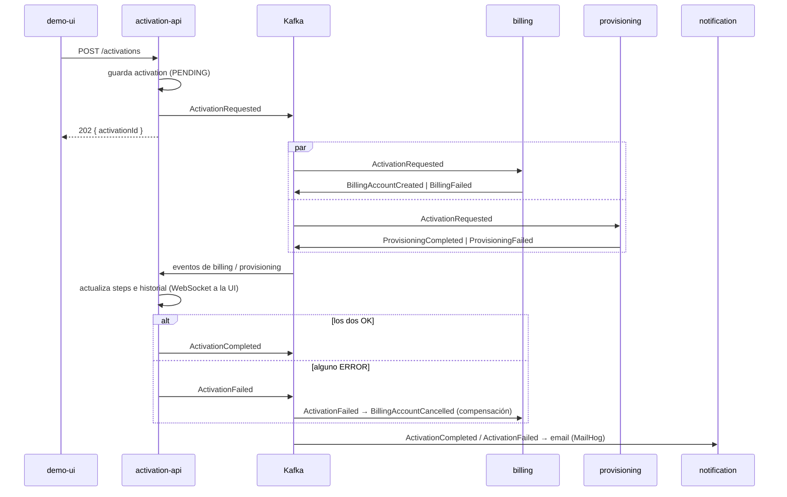

# Arquitectura — POC Activación de Servicios con Kafka

## 1. Objetivo

Demostrar un flujo de **activación de un plan** coordinado por eventos (coreografía + saga con
compensación) sobre Apache Kafka, con microservicios NestJS independientes, cada uno con su
propia base MongoDB, y con las garantías no funcionales pedidas:

| Requisito | Cómo se cumple |
|-----------|----------------|
| **RNF-03 Idempotencia** | Colección `processed_events` por servicio con índice único en `eventId`. El chequeo, el efecto de negocio, la marca y la publicación de eventos corren en **una transacción de MongoDB** (`processIdempotent`). TTL de 7 días. |
| **RNF-04 Reintentos + DLQ** | Decorador `@RetryWithDlq(topic)` de `libs/kafka-toolkit`: intento original + 3 reintentos con backoff exponencial **1s, 2s, 4s**; si sigue fallando publica en `<topic>.dlq` y **no relanza**, así el offset se commitea y la partición sigue avanzando. |
| Escalabilidad horizontal | Topics con 3 particiones y consumer groups. `billing-service` no tiene `container_name`, por lo que se puede escalar (`--scale billing-service=2`). |
| Consumidores tardíos | `loyalty-service` se suscribe con `auto.offset.reset = earliest` y reconstruye su estado leyendo todo el historial. |

## 2. Componentes

```mermaid
flowchart LR
    UI[demo-ui<br/>React + Vite :5173] -- REST / WebSocket --> API
    API[activation-api<br/>:3000] -- activation.requested --> K[(Kafka<br/>KRaft)]
    K -- activation.requested --> BILL[billing-service]
    K -- activation.requested --> PROV[provisioning-service]
    BILL -- billing.events --> K
    PROV -- provisioning.events --> K
    K -- billing.events<br/>provisioning.events --> API
    API -- activation.events --> K
    K -- activation.events --> NOTIF[notification-service]
    K -- activation.events<br/>ActivationFailed --> BILL
    K -- todos los topics --> CRM[crm-analytics-service]
    K -. activation.events<br/>earliest .-> LOY[loyalty-service<br/>profile loyalty :3005]
    NOTIF -- SMTP --> MH[MailHog :8025]
    API --- M1[(activation_api)]
    BILL --- M2[(billing_service)]
    PROV --- M3[(provisioning_service)]
    NOTIF --- M4[(notification_service)]
    CRM --- M5[(crm_analytics_service)]
```

| Servicio | Consume | Produce | Base de datos | Consumer group* |
|----------|---------|---------|---------------|-----------------|
| `activation-api` | `billing.events`, `provisioning.events` | `activation.requested`, `activation.events` | `activations` | `activation-api` |
| `billing-service` | `activation.requested`, `activation.events` (`ActivationFailed`) | `billing.events` | `billing_accounts`, `processed_events` | `billing-svc` |
| `provisioning-service` | `activation.requested` | `provisioning.events` | `provisioning_orders`, `processed_events` | `provisioning-svc` |
| `notification-service` | `activation.events` | — (sólo DLQ) | `notifications`, `processed_events` | `notification-svc` |
| `crm-analytics-service` | los 4 topics de negocio, desde el inicio (RF-10) | — (sólo DLQ) | `event_log`, `processed_events` | `crm-analytics` |
| `loyalty-service` | `activation.events` | — | en memoria | `loyalty-svc` |

Cada servicio tiene su propia base (`activation_api`, `billing_service`, …); ninguno lee la base
de otro. Los consumer groups se llaman exactamente como en el documento de arquitectura: la
configuración común (`kafkaConsumerOptions` en `kafka-toolkit`) desactiva el sufijo `-server`
que NestJS agrega por defecto.

Infraestructura (`docker-compose.yml`): `kafka` (apache/kafka 3.7, modo KRaft), `kafka-init`
(crea los topics y termina), `kafka-ui` (`kafbat/kafka-ui`, :8080), `mongo` 7 como replica set
de un nodo `rs0` (necesario para transacciones) y `mailhog` (:8025).

## 3. Topics

Creados por `docker/create-topics.sh` con **3 particiones**, **retención de 7 días**
(`retention.ms=604800000`) y factor de replicación 1.
Todos los servicios esperan a que `kafka-init` termine (`service_completed_successfully`) para que
Kafka no autocree los topics con una sola partición.

| Topic | Key | Eventos |
|-------|-----|---------|
| `activation.requested` | `customerId` | `ActivationRequested` |
| `billing.events` | `customerId` | `BillingAccountCreated`, `BillingFailed`, `BillingAccountCancelled` |
| `provisioning.events` | `customerId` | `ProvisioningCompleted`, `ProvisioningFailed` |
| `activation.events` | `customerId` | `ActivationCompleted`, `ActivationFailed` |
| `<topic>.dlq` (×4) | `customerId` | Mensajes que agotaron los reintentos |

La key `customerId` garantiza **orden por cliente**: todos los eventos de un cliente van a la misma
partición y los procesa la misma instancia del consumer group.

### Sobre del evento (`libs/contracts`)

```json
{
  "eventId": "uuid v4 — clave de idempotencia",
  "eventType": "ActivationRequested",
  "version": 1,
  "occurredAt": "ISO-8601",
  "correlationId": "act-xxxxxxxx (activationId)",
  "customerId": "C-1234",
  "source": "activation-api",
  "payload": { "planId": "PLAN_DIGITAL", "channel": "web", "simulateFailure": "none" }
}
```

`simulateFailure` sirve para la demo: `none` | `billing` | `provisioning` (fallos de negocio que
disparan la compensación) | `dlq` (fallo técnico en billing que termina en la DLQ).

## 4. Flujo (saga coreografiada)



Estados de la activación: `PENDING → IN_PROGRESS → ACTIVE | FAILED`.

La compensación de billing hace un *upsert* a `CANCELLED`: si `ActivationFailed` llegara antes
que `ActivationRequested`, la cuenta ya queda cancelada y la creación posterior se omite.

## 5. Idempotencia (RNF-03)

`processIdempotent(event, options, handler)` en `libs/kafka-toolkit/src/idempotency.ts`:

1. Abre una transacción con `connection.transaction()` (Mongoose reintenta solo los errores
   transitorios de MongoDB).
2. Si el `eventId` ya está en `processed_events` → `duplicate`, no hace nada.
3. Ejecuta el handler, que recibe `ctx.session` y la usa en todas sus escrituras.
4. Inserta `{ eventId, eventType, topic, createdAt }` en `processed_events` en la misma transacción.
5. Publica los eventos que el handler encoló con `ctx.publish()` y recién después commitea.

Si cualquier paso falla, la transacción se aborta: no queda ni el efecto ni la marca, y el error
sube a `@RetryWithDlq`. Publicar antes del commit da **at-least-once**: si el commit fallara
después de publicar, el evento se reprocesa y se vuelve a publicar con otro `eventId`, algo que
tolera el diseño porque todos los consumidores son idempotentes y el estado final converge.
Si dos instancias insertan el mismo `eventId` a la vez, el índice único rechaza a una (`E11000`)
y se trata como duplicado.

Modelo `ProcessedEvent` (colección `processed_events`, en cada servicio consumidor):

```ts
@Prop({ required: true, unique: true }) eventId: string;
@Prop() eventType?: string;
@Prop() topic?: string;
@Prop({ default: Date.now, expires: 604800 }) createdAt: Date;   // TTL 7 días
```

El TTL coincide con la retención de los topics (7 días): un evento más viejo que eso ya no
puede volver a llegar.

`activation-api` no usa `processed_events`: evita duplicados ignorando un `eventId` que ya figure
en el `history` de la activación.

## 6. Reintentos y DLQ (RNF-04)

`libs/kafka-toolkit/src/retry-dlq.ts`:

```ts
@EventPattern(TOPICS.ACTIVATION_REQUESTED)
@RetryWithDlq(TOPICS.ACTIVATION_REQUESTED)
async handleActivationRequested(@Payload() event: ActivationEvent, @Ctx() _context: unknown) { ... }   // _context = KafkaContext
```

* Intento 1 → falla → espera 1 s → intento 2 → espera 2 s → intento 3 → espera 4 s → intento 4.
* Si el intento 4 falla (o el error es `NonRetriableError`, p. ej. un mensaje sin `eventId`),
  publica en `<topic>.dlq` **el mensaje original** (mismo value y misma key) con el motivo del
  error en los headers:

  | Header | Contenido |
  |--------|-----------|
  | `x-original-topic` | topic de donde se consumió |
  | `x-exception-type` / `x-exception-message` | tipo y mensaje del error |
  | `x-attempts` | intentos realizados |
  | `x-consumer` | `Controller.método` que falló |
  | `x-failed-at` | fecha ISO |
* Los fallos de negocio simulados (`simulateFailure: billing | provisioning`) **no** son errores
  técnicos: se publican como `BillingFailed` / `ProvisioningFailed` y no van a la DLQ. El modo
  `dlq` existe sólo para mostrar un fallo técnico en la demo.
* El decorador **nunca relanza**: el handler de Nest termina bien, el decorador **commitea el
  offset a mano** (`autoCommit: false`; offset + 1, después de procesar, nunca antes) y la
  partición continúa con el siguiente mensaje. Para eso cada handler recibe `@Ctx() KafkaContext`. El mensaje problemático queda aparcado en la DLQ
  para analizarlo o reinyectarlo.
* El productor para la DLQ es la propiedad `kafkaClient` del controller (configurable con
  `clientProperty`). Los servicios que no publican eventos de negocio (notification, crm)
  registran igual un `ClientKafka` en modo `producerOnlyMode` sólo para la DLQ.
* El decorador copia la metadata de Nest (`@EventPattern`, `@Payload`), así que funciona en
  cualquier orden respecto de `@EventPattern`.

Trade-off: los reintentos son **en memoria**. Mientras dura el backoff (como máximo ~7 s más el
tiempo de los intentos) esa partición espera; el resto de las particiones sigue. Es un bloqueo
acotado, muy por debajo del `sessionTimeout` de kafkajs (30 s), así que no provoca rebalanceos.
Para esperas largas, la evolución natural son *retry topics* (`<topic>.retry.1s`, etc.).

## 7. Commit de offsets y outbox

**Offsets.** Todos los consumidores Nest corren con `run.autoCommit = false`. El offset se
commitea en `@RetryWithDlq` sólo cuando el mensaje terminó, procesado o enviado a la DLQ. Si el
servicio se cae antes, al volver relee desde el último offset confirmado (RNF-05, Escenario 3) y
la idempotencia descarta lo que ya se había aplicado.

**Outbox (fase 4, no implementado).** Según el plan de fases, en las fases 1 a 3 los eventos se
publican directo después de guardar. Riesgo aceptado y documentado:

* `activation-api` guarda la activación y después publica `ActivationRequested`. Si el proceso se
  cae entre las dos operaciones, la activación queda `PENDING` y el evento se pierde.
* En billing y provisioning el riesgo es menor: la publicación ocurre **dentro** de la transacción
  de idempotencia, antes del commit de Mongo. Si la publicación falla se aborta todo y el mensaje
  se reintenta. Si el commit falla después de publicar, el evento puede salir dos veces, algo que
  los consumidores toleran.
* La solución de fase 4: colección `outbox` (índice `status + createdAt`) escrita en la misma
  transacción y un publicador que la lee cada 500 ms. Mongo ya corre como replica set, así que
  no hay que cambiar infraestructura.

## 8. Escalado (Escenario 4)

`billing-service` no tiene `container_name`, así que Compose puede crear varias réplicas:

```bash
docker compose up -d --scale billing-service=2
```

Las dos réplicas comparten el grupo `billing-svc` y Kafka les reparte las 3 particiones de
`activation.requested` (2 + 1). Si una cae, el rebalanceo asigna sus particiones a la otra. La
idempotencia evita doble facturación si un mensaje se entrega de nuevo durante el rebalanceo.

## 9. Consumidor tardío (Escenario 5)

`loyalty-service` (kafkajs puro, sin Nest ni Mongo) suma 100 puntos por cada
`ActivationCompleted`. Está detrás del perfil `loyalty`, así que no arranca con el resto.

`auto.offset.reset = earliest` (en kafkajs: `subscribe({ fromBeginning: true })`) aplica sólo
cuando el grupo **no tiene offsets commiteados**: la primera vez que arranca `loyalty-svc` lee
`activation.events` desde el offset 0 y reconstruye los puntos de activaciones ocurridas antes de
que el servicio existiera. En los arranques siguientes continúa desde su último offset. Para
repetir la demo desde cero hay que usar otro `KAFKA_GROUP_ID` o resetear los offsets del grupo.

Expone `GET /loyalty` y `GET /loyalty/:customerId` en el puerto 3005.

## 10. Estructura del repositorio

```
activation-poc/
├── apps/
│   ├── activation-api/          REST + WebSocket + orquestación del estado
│   ├── billing-service/
│   ├── provisioning-service/
│   ├── notification-service/
│   ├── crm-analytics-service/
│   ├── loyalty-service/         Escenario 5 (profile "loyalty")
│   └── demo-ui/
├── libs/
│   ├── contracts/               Tipos de eventos y nombres de topics
│   └── kafka-toolkit/           @RetryWithDlq, processIdempotent, kafkaConsumerOptions
├── docker/                      Dockerfiles y create-topics.sh
├── docs/
│   ├── architecture.md
│   └── demo-script.md
└── docker-compose.yml
```

Compilación: TypeScript 7 (`baseUrl` ya no existe; cada paquete tiene su `tsconfig.json` con
`rootDir: ./src`, `types: ["node"]`). Orden: `contracts` → `kafka-toolkit` → servicios
(`npm run build` en la raíz lo respeta). Las imágenes usan `node:22-alpine`, porque los paquetes
de NestJS 12 son sólo-ESM y el código compila a CommonJS (`require(esm)`).
